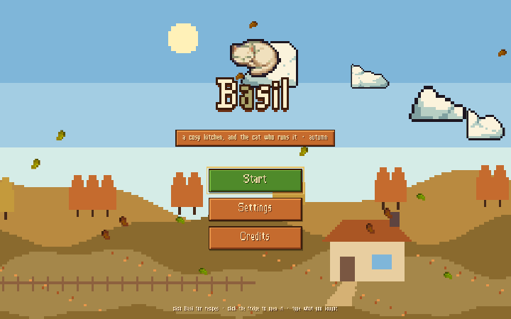
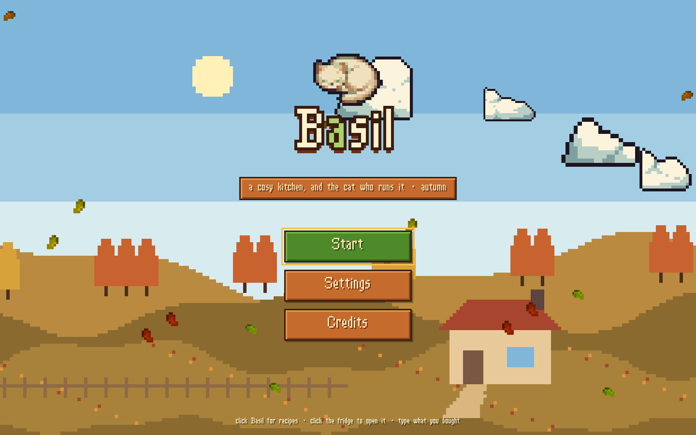
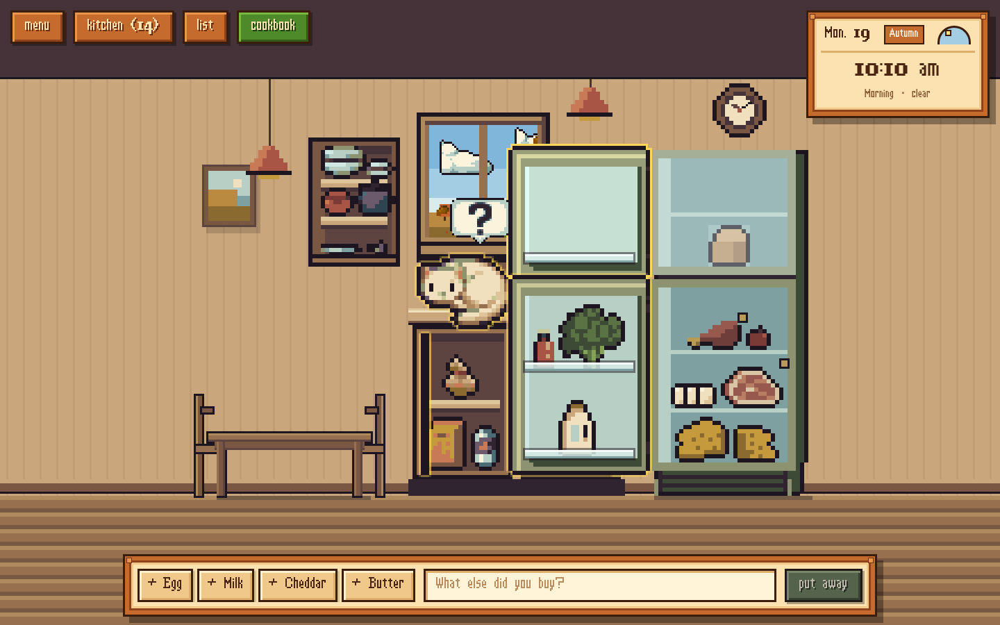
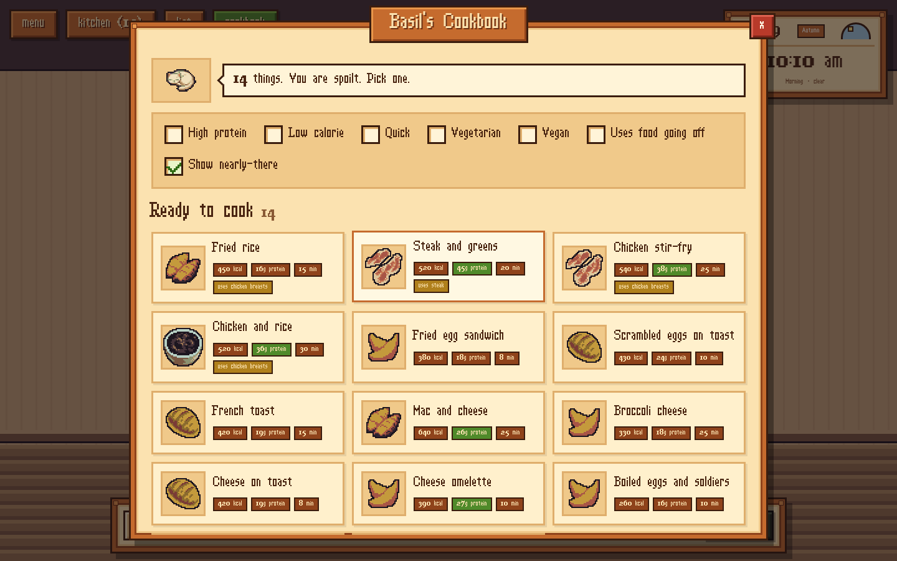
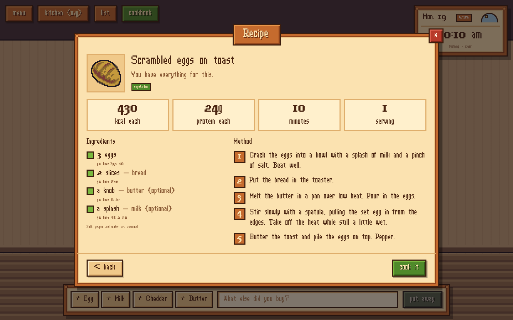
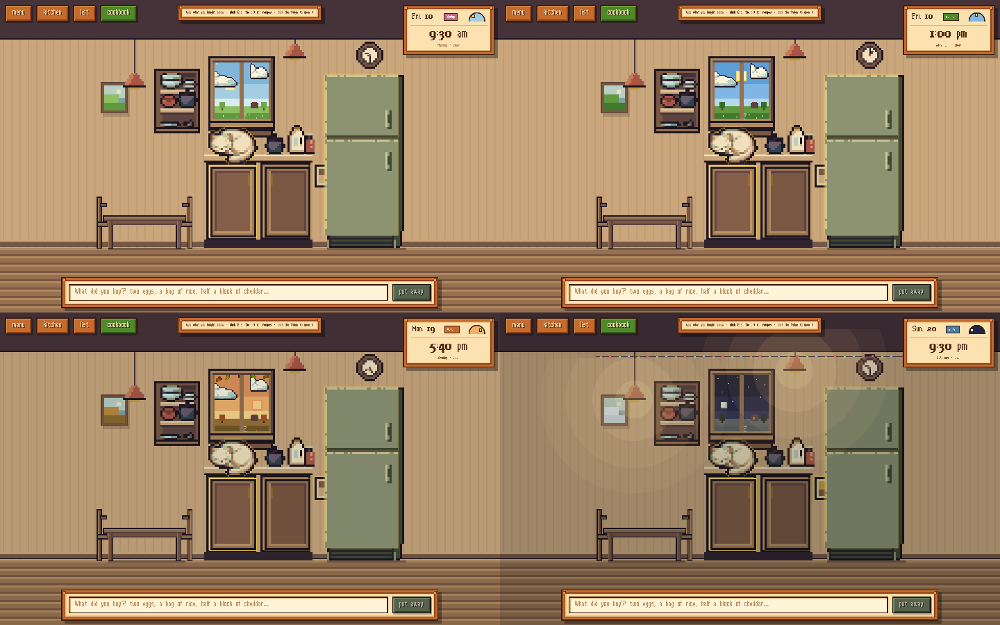

# Basil

**A cosy pixel-art kitchen that knows what's in your fridge.** Type what you
bought, watch it land on the shelves, and let Basil the cat tell you what you
can cook with it.

A side project made for fun: a small, finished game rather than another
dashboard, built with the same care for testing and security as my main
work (see [More of my work](#more-of-my-work)).

**[Play it → basil-cat.vercel.app](https://basil-cat.vercel.app)**

[](https://github.com/aboodgitawaida/Basil/actions/workflows/ci.yml)


[](LICENSE)



| | |
|---|---|
|  |  |
|  |  |

## What it does

- **One-line shopping entry.** Type `two eggs, 2 bags of milk, half a block of
  cheddar` and press Enter. Each thing is read into a clean label, a quantity
  and a kind ("Cheddar, half, a cheese"), put on the right shelf, and the door
  swings open so you see it land. There's no form and no confirm step: every
  change has an undo.
- **A real kitchen to look in.** The fridge, freezer and both cupboards open.
  Food is laid out on actual shelves: bottles in the door, tall things on the
  tall shelf, never stacked on top of each other.
- **Basil's cookbook.** Click the cat. He wakes, stretches and shows everything
  you can make right now, plus what you're one or two things short of. You can
  filter by high protein, low calorie, quick, vegetarian, vegan or "uses food
  going off". Every recipe has a full method, calories and protein per serving.
  With an AI key, Basil adds ideas of his own; without one, the 46 built-in
  recipes still work.
- **A shopping list that fills itself.** Anything that runs out goes on it.
  Recipes you're short for add their missing ingredients in one click. Tick
  something off in the shop and it goes straight into the kitchen.
- **A world that follows yours.** The window shows your real time of day (sun,
  moon, stars, dawn and dusk), the current season, and optionally your local
  weather. The wall clock tells the real time.



## How it's built

- **React 18 + TypeScript (strict) + Vite.** No game engine: the room is DOM
  elements placed in "art pixels" (1 px = 1 cm) and scaled by one whole
  number, so pixel art never blurs. Phones and portrait tablets get the
  kitchen half of the room at a larger scale, and everything works from the
  keyboard as well as with a mouse or a finger.
- **AI behind a serverless function.** `/api/parse` and `/api/suggest` run in
  one Vercel function (`api/[...path].ts`); locally the same handlers run
  inside Vite or Express. Supports Gemini or Groq with JSON-schema output, and
  every reply is strictly validated before the app trusts it.
- **Works without AI.** A keyword parser and a built-in recipe book are the
  fallback for a missing key, a slow model, a bad reply or no network. The
  app never blocks on the model: reading a list gives up after 8 seconds.
- **Local-first.** Everything is saved in `localStorage` behind a `Repository`
  interface, with versioned migrations. No accounts. The only things that
  leave the browser are what you type and what's in your kitchen (sent to
  the model to read it), and your rough location, only if you switch on real
  weather.
- **Pure logic, well tested.** Parsing, shelf layout (`src/lib/arrange.ts`),
  recipe matching, the shopping list, storage migrations, room scaling and the
  API are covered by 183 unit tests (Vitest), plus a Playwright test that
  plays through the main loop at desktop and phone sizes. CI runs the
  typecheck, tests, build and browser test on every push.
- **One art style from eight packs.** `tools/` is a Python pipeline that crops
  every sprite, remaps it onto one 27-colour palette, gives it the same
  outline and scales it to world size, then draws the room, the open doors,
  Basil's awake poses and a few dishes the packs didn't have. See
  [tools/README.md](tools/README.md).

```
src/
  scene/   the room: fridge, cupboards, window, Basil, clock
  ui/      menus: cookbook, shopping list, settings, title screen
  lib/     pure logic: parsing, recipes, layout, storage, time and seasons
server/    API handlers, providers, schemas, rate limit (shared by Vercel and Express)
api/       the Vercel entry point
tools/     the sprite pipeline (Python)
scripts/   Playwright smoke test and README screenshots
test/      unit tests
```

### Security

The model key is read server-side only and never reaches the browser bundle.
The API refuses requests made from other websites, caps calls per visitor
(20 a minute, 300 a day by default), limits body size, and never passes the
provider's own error text back to the browser. The site sends a strict
Content Security Policy and the usual hardening headers (`vercel.json`), and
`npm audit` is clean.

## Running it

Needs Node 22.12 or newer.

```sh
npm install
cp .env.example .env     # optional: add GROQ_API_KEY or GEMINI_API_KEY
npm run dev              # http://localhost:5173
```

Without a key, everything works on the built-in reader and cookbook.

```sh
npm test            # unit tests
npm run typecheck   # client, server and tests
npx playwright install chromium        # once, for the browser tests
npm run build && npm run smoke         # end-to-end smoke test
npm run build && npm run screenshots   # regenerate docs/ (then python3 -I tools/gif.py)
```

Add `?season=winter` (or spring, summer, autumn) to the URL to preview a
season, or `?debug` to check the sprite manifest.

### The AI key

One line in `.env` (or in the host's environment variables):

```
BASIL_PROVIDER=groq        # or gemini
GROQ_API_KEY=...           # or GEMINI_API_KEY
```

`BASIL_MODEL` pins a model name. `BASIL_RATE_PER_MIN` and `BASIL_RATE_PER_DAY`
change the per-visitor caps. The counts live in memory per serverless
instance, so also set a spending limit in your provider's dashboard.

### Deploying

Import the repo on Vercel; it detects Vite. Add the variables above under
Environment Variables and deploy. `/api/*` runs as one serverless function.

## Credits

The art, fonts and sound come from free packs by KARSIORI, Frostwindz,
ToffeeCraft, Riley (rkuhlf-assets), Stealthix, Emi Emi Games, tiopalada,
Kenney and Redlight_Chill; see [CREDITS.md](CREDITS.md) for links and
licences. The code is MIT-licensed; the art and audio are not covered by
that licence.

## Author

**Abood Awaida** · [GitHub](https://github.com/aboodgitawaida) · [LinkedIn](https://www.linkedin.com/in/abood-awaida/)

## More of my work

- **[Courseflix](https://github.com/aboodgitawaida/Courseflix)**: Netflix-style course discovery for UTM students, with reviews, recommendations and 2,600+ courses. [courseflix.ca](https://www.courseflix.ca)
- **[LotPulse](https://github.com/aboodgitawaida/LotPulse)**: live, student-reported parking enforcement alerts for UTM campus lots. [lotpulse-utm.vercel.app](https://lotpulse-utm.vercel.app)
- **[Vitals](https://github.com/aboodgitawaida/Vitals)**: camera-based heart-rate estimation from an ordinary laptop webcam, run entirely on your own machine. [vitals-track.vercel.app](https://vitals-track.vercel.app)
